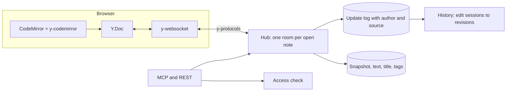

# Architecture

greydoc is one Go process. It serves the React UI, a JSON API, a websocket for live editing, and the MCP endpoint.

## Live editing

Each document is a Yjs document. The browser uses the standard Yjs stack (yjs, y-websocket, y-codemirror.next). The server uses [ygo](https://github.com/Deln0r/ygo), a pure Go port of Yjs, so the binary needs no JavaScript runtime and no cgo. Only `internal/collab/crdt.go` imports ygo.

A room loads when the first person opens a document and closes ten seconds after the last one leaves. While open, it logs updates every second and saves a snapshot every five seconds.

## Authorship

Every Yjs item carries the client ID of the replica that created it. The hub keeps a registry from client ID to person and source (`human`, `ai_assisted`, `agent`, `restore`).

- A browser claims a new client ID with its first edit. The hub rejects an update that adds items under a client ID owned by someone else.
- Every server edit (accepted suggestion, agent edit, restore) uses a new client ID registered with its source.
- The authors view walks the Yjs items in the browser and maps client IDs through the registry.

Accepted suggestions are attributed to the suggestion's author and source. The person who accepted it is recorded in the timeline.

## History

The update log holds each change with its author and source. A background worker groups updates into edit sessions: a session ends after two minutes without edits or after fifteen minutes. People typing together share a session. AI-assisted, agent and restore changes always get their own. Each session becomes a revision with the text after it and a unified diff. Old log entries are deleted once the snapshot and the history include them.

Comments, suggestions, permission changes and alias changes are audit events. The timeline shows revisions and events together.

## Comments and suggestions

Comment and suggestion anchors are Yjs relative positions, so they follow the text while others edit. When the anchored text is deleted, a comment shows as detached. A suggestion whose text changed since it was made is stale: accepting it asks for a confirmation.

AI actions in the editor never change text. They create suggestions with source `ai_assisted`.

## Access

Levels are deny, read, comment, write and full (owner). A person gets the highest of their own grant, their groups' grants, the signed-in grant, and the everyone grant. Guests get the everyone grant, capped by `GREYDOC_GUEST_MAX`. A view-only link gives read. Agents are also capped by the document's agent policy. In local mode every request has full access.

## Trash and audit

Deleting a document moves it to the trash: it leaves lists and search, and its live room closes. The owner, or an admin, restores it or deletes it for good. A background job deletes documents older than the retention period. Agents can trash and restore but never delete for good.

The audit log is the `audit_event` table. It holds document events (creation, trash, restore, deletion, permissions, comments, suggestions, restored versions) account events (sign-ins, access tokens, connected agents), and every MCP tool call and session. Events outlive their documents. Text edits are recorded as revisions in each document's timeline.

## Files

The database is the source of truth. The data directory holds uploads and the server secret only. Markdown and HTML are exported on demand.

## Limits

- One server per database in normal operation. Live state is in memory. Two servers can overlap during a deploy.
- Search is full text (SQLite FTS5 or Postgres `tsvector`), not semantic.
- Diagram types other than Mermaid, embeds, and import from HedgeDoc are not supported yet.
