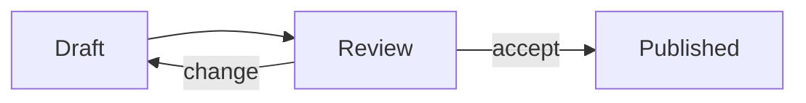
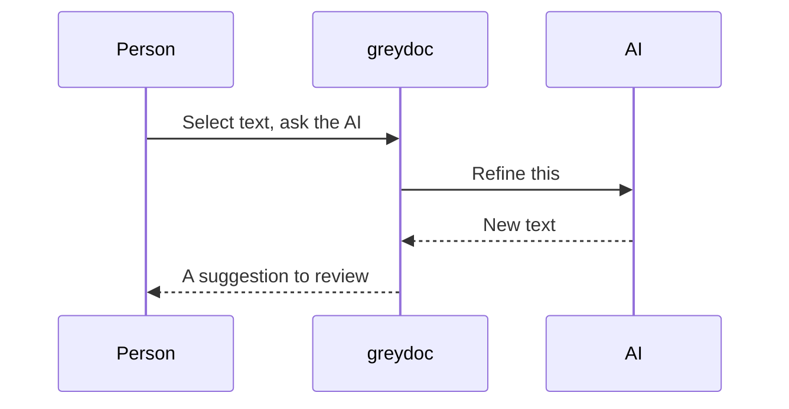

# Features

## Introduction

greydoc is a collaborative Markdown editor. Several people edit the same document at the same time. Every change keeps its author and how it was made: by hand, with AI help, or by an AI agent.

greydoc keeps the addresses and the Markdown of HedgeDoc 1, so old links and old documents keep working.

## Workspace

On wide screens, a table of contents shows to the right of the document. You find it on the view page and in the preview-only mode of the editor. It shows the top-level headings and opens the sub-headings of the section that you read. **Expand all** shows every heading.

### Modes

The buttons at the top of a document switch the mode:

| Mode | What you see | Shortcut |
|---|---|---|
| Live | Markdown renders, except on the line you edit | Ctrl+Alt+L |
| Editor | The Markdown text only | Ctrl+Alt+E |
| Split (default) | The text and the preview side by side | Ctrl+Alt+B |
| Preview | The rendered document only | Ctrl+Alt+V |

On a Mac, use Cmd in place of Ctrl. The address can also set the mode: `?edit`, `?both` or `?view`. The mode keys do nothing while a dialog is open or while you type in another text field.

### Editor shortcuts

These keys work while the editor has focus, in Live, Editor and Split modes. Press the same key again to remove the formatting. If you can only comment, the key opens a suggestion with the formatted text.

| Shortcut | Action | Markdown |
|---|---|---|
| Ctrl+B | Bold | `**text**` |
| Ctrl+I | Italic | `*text*` |
| Ctrl+U | Underline | `++text++` |
| Ctrl+Shift+X | Strikethrough | `~~text~~` |
| Ctrl+Shift+H | Highlight | `==text==` |
| Ctrl+E | Inline code | `` `text` `` |
| Ctrl+. | Superscript | `^text^` |
| Ctrl+, | Subscript | `~text~` |
| Ctrl+K | Link | `[text](url)` |
| Ctrl+Alt+1 to 6 | Heading 1 to 6 | `#` to `######` |
| Ctrl+Alt+0 | Normal text | |
| Ctrl+Shift+7 | Numbered list | `1.` |
| Ctrl+Shift+8 | Bulleted list | `-` |
| Ctrl+Shift+9 | Task list | `- [ ]` |
| Ctrl+Alt+M | Comment on the selection | |

Ctrl+S does nothing: greydoc saves as you type. On a Mac, use Cmd in place of Ctrl.

### Live mode

Live mode renders headings, lists, tables, math and diagrams in place. The line under the cursor shows its Markdown, so you can edit it. The front matter folds into tag chips. If you can edit the document, a click on a task box changes the task.

### Night mode

The account menu switches between light and dark. greydoc remembers your choice.

### Markdown help

**Markdown help** in the account menu opens a short guide to the Markdown syntax, with each example rendered next to its source.

## Writing together

### Real time

Everyone who opens a document edits the same text. You see the cursors and the names of the other people. If your connection drops, your edits wait and merge when it comes back.

### Who wrote what

**Who wrote what** in the **...** menu shows the authors view. Each part of the text gets the color of the person who wrote it. Text that came from an AI suggestion is marked as AI-assisted. Text that an agent wrote is marked as agent text.

### Links to other documents

Write `[[` in the editor. A list of documents opens, and the search narrows it as you type. Pick a document to insert a link such as `[[q4-roadmap|Q4 platform roadmap]]`. The part before `|` is the address of the document, and the part after it is the text of the link. Edit the text as you like. If someone renames the document, the address stays the same, and the link keeps working. A link without text, such as `[[q4-roadmap]]`, shows the current title of the document. A link to an address with no document shows as a dashed link.

To link to one section of another document, add `#` and the section after the address: `[[q4-roadmap#risks]]` or `[[q4-roadmap#risks|the risks]]`. In the editor, type `#` after the address, and a list of the headings of that document opens. Pick a heading to insert the link. A link without text shows the title of the document and the heading, such as "Q4 platform roadmap › Risks". If the document has no such heading, for example after someone renames it, the link shows as a dashed link.

### Links to headings

Every heading has an address. Put the pointer on a heading, and a link icon shows to its left. Click the icon to copy the address of that heading. Send this address to someone, and the document opens at that heading.

The address of a heading is the document address, `#` and the heading text in lowercase, with a `-` in place of each space. Characters other than letters, digits and `-` are removed. For example, `## Release plan` gets `#release-plan`. If two headings have the same text, the second one gets `-1` at the end, the third `-2`, and so on.

To link to a heading in the same document, write `[the release plan](#release-plan)`. Addresses from HedgeDoc 1 with capital letters, such as `#Release-Plan`, also work.

### Images

Paste an image or drop it in the editor. greydoc uploads it and inserts the Markdown link.

## Review

### Comments

Select text and pick **Comment**. A comment is a remark on that text. The text does not change. Others can reply. When the point is settled, resolve the thread. You can reopen it later.

### Suggestions

Select text and pick **Suggest**. A suggestion proposes new text. A person who can edit the document accepts or rejects it. People who can only comment make a suggestion each time they type.

### Mentions

Mentions need sign-in, so they do not exist in local mode. Type `@` in the text, a comment, a reply or a suggestion, then pick a person. The text gets `[@Alice Martin](@alice)`, which shows as a chip with the current name of the person. Press Esc to close the list and keep a plain `@`. A plain `@` notifies nobody.

The bell in the header shows your mentions. A mention in a comment or a suggestion notifies at once. A mention in the text notifies when the edit session ends, that is after 2 minutes without edits or when the last editor leaves. A person gets one notification per mention, and none for their own mentions. A person who cannot open the document gets no notification. The list marks them, and the owner can give them comment access from there.

### AI assistant

Select text and pick **AI**. Type what the AI must do with the selection, then press Enter. Below the text box, presets do common jobs in one click:

- Fix spelling and grammar
- Make it clearer
- Make it shorter
- Make a diagram below

Each preset shows the exact instruction that the model gets. The server administrator can change the presets.

The result is always a suggestion. The AI never changes the document by itself. Before you accept, you can ask the AI to revise the suggestion, for example "make it vertical". Accepted text stays marked as AI-assisted.

## Agents (MCP)

AI agents such as Claude Code and opencode connect to greydoc over MCP. They sign in with OAuth or an access token from the settings page. An agent acts for a person and never gets more access than that person.

Each document has an agent policy, set in the **Share** dialog:

| Policy | Agents can |
|---|---|
| No agent access | Nothing. The document is invisible to agents. |
| Read | Read the document, its comments and its history |
| Suggest | Also comment and suggest. Their edits become suggestions. |
| Edit | Also edit the text directly |

A document that a person creates starts at Suggest. A document that an agent creates starts at Edit, so the agent can keep working on its own draft.

An agent can add images and PDF files to a document. It asks greydoc for a one-time upload URL and sends the file with `curl`. The file does not pass through the model.

## History and audit

### Timeline

**Timeline** in the **...** menu opens the history of the document. It lists edit sessions, comments, suggestions and permission changes, with the person and the source of each. Open an entry to see the diff, or restore an older version. For an AI suggestion, the entry shows the action that you picked, your own words, and the model. **Show the full prompt** shows the exact text sent to the model.

### Audit log

The **Audit log** in the account menu lists every recorded action on the server. That includes every MCP call, with its tool, arguments, client and duration. A summary shows agent use by tool, client and person.

## Share and protect

The **Share** dialog sets who can read, comment or edit. You can give access to everyone with the address, to signed-in users, to a group or to named people. The search lists only people who signed in to greydoc at least once. You can only pick a group that you belong to. Admins can pick any group. Grants to OIDC group names from older versions were removed on upgrade, and the history of each document shows the removal. A group linked to an OIDC group, below, replaces them.

### Groups

Admins manage groups on the **Groups** page in the account menu. A group is one of two kinds, and the kind does not change after creation:

- **Managed in greydoc.** An admin adds and removes members. A person must sign in once before an admin can add them.
- **From an OIDC group.** The members are the people whose OIDC groups include the linked name, as of their last sign-in. Change the members in your identity provider.

Removing a member or deleting a group ends the access at once, also in an open editor. Deleting a group removes its grants. Group changes show in the audit log. Groups are not available in local mode.

| HedgeDoc 1 mode | greydoc access |
|---|---|
| freely | Everyone can edit |
| editable | Signed-in users can edit, everyone can read |
| limited | Signed-in users can edit, others have no access |
| locked | Only the owner edits, everyone can read |
| protected | Only the owner edits, signed-in users can read |
| private | Only the owner |

A **view-only link** gives a client the rendered document, with no editor and no comments. The link is short, such as `https://notes.example.com/v/k3J9xQ2mT7aB1cD4`. You can revoke it at any time.

## Documents

### Document list

The home page lists your recent documents, your own documents and the documents shared with you. Each document shows its owner, its view count and its tags. Pin a document to keep it at the top.

### Tags

Put tags in the front matter:

```yaml
---
tags: [roadmap, q4]
---
```

Click a tag to show only the documents that have it.

### Search

The search field finds words in titles, tags and text.

### Trash

Moving a document to the trash hides it. The owner can restore it from the trash page until the server deletes it for good.

## Slides

Open the **...** menu and pick **Slide mode**. Put `type: slide` in the front matter to mark the document as a presentation, as in HedgeDoc. The document list and the top bar then show a **Present** button. A line with `---` starts a new slide, and `----` starts a slide below the current one. Text after `note:` goes to the speaker notes.

In slide mode:

- **Esc** shows all slides.
- **D** switches between the light and the dark deck.
- **S** opens the speaker view.

Front matter options:

```yaml
---
type: slide
slideOptions:
  theme: black
  transition: fade
  slideNumber: c/t
---
```

## Export and import

The **...** menu downloads the document as Markdown or as one HTML file with its styles. The view page is at `/s/<address>`, and the slides are at `/p/<address>`.

**Download with uploads (.zip)** saves the document with its images and files, to move it to another greydoc server. The zip holds:

- the document as a Markdown file at the root, with links such as `uploads/diagram.png`
- an `uploads/` folder with the files that the document shows
- a `note.json` file with the addresses, dates, agent policy and, for the owner, the access settings

The unpacked folder opens in any Markdown editor, and the images show.

To import, drop the zip on the document list. A dropped Markdown file becomes a new document too. An imported document keeps its address and its dates. If another document already has the address, the imported document gets a new address, and a message shows it. Access settings for people who have no account on the new server are left out. History, comments and suggestions stay on the old server.

## Extra syntax

### Typography

**bold**, *italic*, ~~deleted~~, ==marked==, ++inserted++, H~2~O, x^2^, and emoji :smile:.

### Blockquote

> A quote can hold **Markdown** too.

### Alerts

> [!NOTE]
> Good to know.

> [!TIP]
> A better way to do it.

> [!WARNING]
> Check this first.

:::success
A box. Also `:::info`, `:::warning` and `:::danger`.
:::

:::spoiler Open me
Hidden until you open it.
:::

### Code

```js
// Code blocks are highlighted.
function greet(name) {
  return `Hello, ${name}`
}
```

### Tables

| Left | Center | Right |
|:-----|:------:|------:|
| a | b | c |

```csvpreview header="true"
name,team
Ana,Search
Bo,Infra
```

### Math

Inline math: $E = mc^2$.

$$
\int_0^1 x^2 \, dx = \frac{1}{3}
$$

### Diagrams





Hold Ctrl or Cmd and scroll over a diagram to zoom at the pointer. Drag to pan. The diagram toolbar opens full screen and copies the diagram as SVG or PNG.

### Images with a size

```markdown


```

 

### Footnotes

A claim that needs a source.[^1]

[^1]: The source.

### Task lists

- [x] Write the draft
- [ ] Ask for a review
