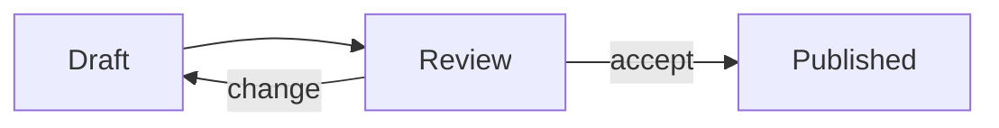
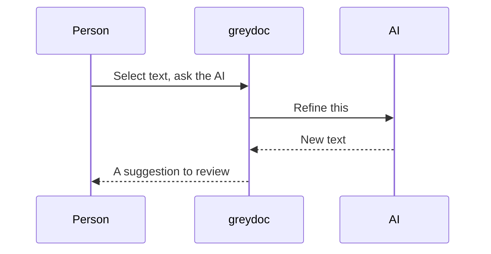

# Features

## Introduction

greydoc is a collaborative Markdown editor. Several people edit the same note at the same time. Every change keeps its author and how it was made: by hand, with AI help, or by an AI agent.

greydoc keeps the addresses and the Markdown of HedgeDoc 1, so old links and old notes keep working.

## Workspace

On wide screens, a table of contents shows to the right of the note. You find it on the view page and in the preview-only mode of the editor. It shows the top-level headings and opens the sub-headings of the section that you read. **Expand all** shows every heading.

### Modes

The buttons at the top of a note switch the mode:

| Mode | What you see | Shortcut |
|---|---|---|
| Live | Markdown renders, except on the line you edit | Ctrl+Alt+L |
| Editor | The Markdown text only | Ctrl+Alt+E |
| Split (default) | The text and the preview side by side | Ctrl+Alt+B |
| Preview | The rendered note only | Ctrl+Alt+V |

On a Mac, use Cmd in place of Ctrl. The address can also set the mode: `?edit`, `?both` or `?view`.

### Live mode

Live mode renders headings, lists, tables, math and diagrams in place. The line under the cursor shows its Markdown, so you can edit it. The front matter folds into tag chips. If you can edit the note, a click on a task box changes the task.

### Night mode

The moon button in the top bar switches between light and dark. greydoc remembers your choice.

### Markdown help

The **?** button in the top bar opens a short guide to the Markdown syntax, with each example rendered next to its source.

## Writing together

### Real time

Everyone who opens a note edits the same text. You see the cursors and the names of the other people. If your connection drops, your edits wait and merge when it comes back.

### Who wrote what

The people button shows the authors view. Each part of the text gets the color of the person who wrote it. Text that came from an AI suggestion is marked as AI-assisted. Text that an agent wrote is marked as agent text.

### Links to other notes

Write `[[` in the editor. A list of notes opens, and the search narrows it as you type. Pick a note to insert a link such as `[[q4-roadmap|Q4 platform roadmap]]`. The part before `|` is the address of the note, and the part after it is the text of the link. Edit the text as you like. If someone renames the note, the address stays the same, and the link keeps working. A link without text, such as `[[q4-roadmap]]`, shows the current title of the note. A link to an address with no note shows as a dashed link.

### Images

Paste an image or drop it in the editor. greydoc uploads it and inserts the Markdown link.

## Review

### Comments

Select text and pick **Comment**. A comment is a remark on that text. The text does not change. Others can reply. When the point is settled, resolve the thread. You can reopen it later.

### Suggestions

Select text and pick **Suggest**. A suggestion proposes new text. A person who can edit the note accepts or rejects it. People who can only comment make a suggestion each time they type.

### AI assistant

Select text and pick **AI**:

- Refine
- Shorten
- Fix spelling and grammar
- Continue writing
- Make a diagram below

The result is always a suggestion. The AI never changes the note by itself. Before you accept, you can ask the AI to revise the suggestion, for example "make it vertical". Accepted text stays marked as AI-assisted.

## Agents (MCP)

AI agents such as Claude Code and opencode connect to greydoc over MCP. They sign in with OAuth or an access token from the settings page. An agent acts for a person and never gets more access than that person.

Each note has an agent policy, set in the **Share** dialog:

| Policy | Agents can |
|---|---|
| No agent access | Nothing. The note is invisible to agents. |
| Read | Read the note, its comments and its history |
| Suggest | Also comment and suggest. Their edits become suggestions. |
| Edit | Also edit the text directly |

A note that a person creates starts at Suggest. A note that an agent creates starts at Edit, so the agent can keep working on its own draft.

An agent can add images and PDF files to a note. It asks greydoc for a one-time upload URL and sends the file with `curl`. The file does not pass through the model.

## History and audit

### Timeline

The clock button opens the timeline of the note. It lists edit sessions, comments, suggestions and permission changes, with the person and the source of each. Open an entry to see the diff, or restore an older version. For an AI suggestion, the entry shows the action that you picked, your own words, and the model. **Show the full prompt** shows the exact text sent to the model.

### Audit log

The **Audit log** in the account menu lists every recorded action on the server. That includes every MCP call, with its tool, arguments, client and duration. A summary shows agent use by tool, client and person.

## Share and protect

The **Share** dialog sets who can read, comment or edit. You can give access to everyone with the address, to signed-in users, to OIDC groups or to named people.

| HedgeDoc 1 mode | greydoc access |
|---|---|
| freely | Everyone can edit |
| editable | Signed-in users can edit, everyone can read |
| limited | Signed-in users can edit, others have no access |
| locked | Only the owner edits, everyone can read |
| protected | Only the owner edits, signed-in users can read |
| private | Only the owner |

A **view-only link** gives a client the rendered note, with no editor and no comments. The link is short, such as `https://notes.example.com/v/k3J9xQ2mT7aB1cD4`. You can revoke it at any time.

## Notes

### Note list

The home page lists your recent notes, your own notes and the notes shared with you. Each note shows its owner, its view count and its tags. Pin a note to keep it at the top.

### Tags

Put tags in the front matter:

```yaml
---
tags: [roadmap, q4]
---
```

Click a tag to show only the notes that have it.

### Search

The search field finds words in titles, tags and text.

### Trash

Moving a note to the trash hides it. The owner can restore it from the trash page until the server deletes it for good.

## Slides

Open the **...** menu and pick **Slide mode**. A line with `---` starts a new slide, and `----` starts a slide below the current one. Text after `note:` goes to the speaker notes.

In slide mode:

- **Esc** shows all slides.
- **D** switches between the light and the dark deck.
- **S** opens the speaker view.

Front matter options:

```yaml
---
slideOptions:
  theme: black
  transition: fade
  slideNumber: c/t
---
```

## Export and import

The **...** menu downloads the note as Markdown or as one HTML file with its styles. The view page is at `/s/<address>`, and the slides are at `/p/<address>`.

**Download with uploads (.zip)** saves the note with its images and files, to move it to another greydoc server. The zip holds:

- the note as a Markdown file at the root, with links such as `uploads/diagram.png`
- an `uploads/` folder with the files that the note shows
- a `note.json` file with the addresses, dates, agent policy and, for the owner, the access settings

The unpacked folder opens in any Markdown editor, and the images show.

To import, drop the zip on the note list. A dropped Markdown file becomes a new note too. An imported note keeps its address and its dates. If another note already has the address, the imported note gets a new address, and a message shows it. Access settings for people who have no account on the new server are left out. History, comments and suggestions stay on the old server.

## Extra syntax

### Typography

**bold**, *italic*, ~~deleted~~, ==marked==, ++inserted++, H~2~O, x^2^, and emoji :smile:.

### Blockquote

> A quote can hold **Markdown** too.

### Alerts

> [!NOTE]
> Good to know.

> [!TIP]
> A better way to do it.

> [!WARNING]
> Check this first.

:::success
A box. Also `:::info`, `:::warning` and `:::danger`.
:::

:::spoiler Open me
Hidden until you open it.
:::

### Code

```js
// Code blocks are highlighted.
function greet(name) {
  return `Hello, ${name}`
}
```

### Tables

| Left | Center | Right |
|:-----|:------:|------:|
| a | b | c |

```csvpreview header="true"
name,team
Ana,Search
Bo,Infra
```

### Math

Inline math: $E = mc^2$.

$$
\int_0^1 x^2 \, dx = \frac{1}{3}
$$

### Diagrams





Hold Ctrl or Cmd and scroll over a diagram to zoom at the pointer. Drag to pan. The diagram toolbar opens full screen and copies the diagram as SVG or PNG.

### Images with a size

```markdown


```

 

### Footnotes

A claim that needs a source.[^1]

[^1]: The source.

### Task lists

- [x] Write the draft
- [ ] Ask for a review
